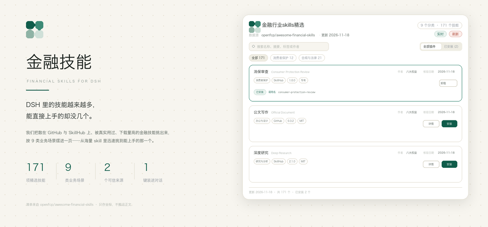
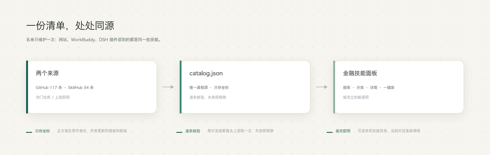
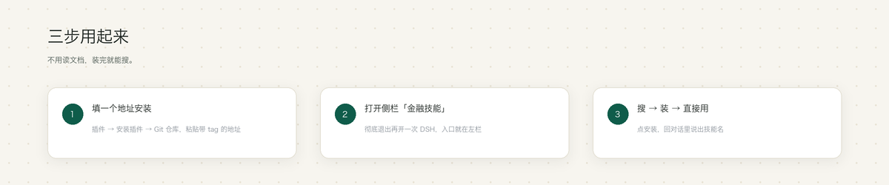

<h1 align="center">A DSH plugin that puts the curated financial skills in your left sidebar</h1>

<p align="center"><b>Financial skills you can search, install in one click — and use in the conversation you already have open.</b></p>



<p align="center">
  <a href="#three-steps"><b>→ Install in three steps</b></a>　·　
  <a href="https://openfcp.github.io/awesome-financial-skills/">Live catalog</a>　·　
  <a href="docs/preview.html">Layout preview</a>　·　
  <a href="CHANGELOG.md">Changelog</a>　·　
  <a href="README.md">中文</a>
</p>

<p align="center">
  
  
  
  
  
  <a href="https://github.com/openfcp/dsh-financial-skills/actions/workflows/ci.yml"></a>
</p>

Install once and DeepSeek Harness gains a “Financial Skills” entry in its sidebar: a full page of curated skills grouped by business scenario — search, filter, read the SKILL.md, install with one click, and use it in the current conversation without a restart.

There is exactly one goal here: **help financial practitioners go from a sea of skills to the one that actually does the job** — without reading twenty READMEs first.

---

## Why it exists

The skill ecosystem grows weekly. The hard part is no longer *finding* something; it is **daring to install it, knowing how to use it, and knowing where its boundaries are**.

| Your problem | What this plugin does |
|---|---|
| Too many skills, all with confident titles, none that do real work | Only skills tied to a **concrete job**: consumer-protection review, reconciliation, KYC, research Q&A, official documents. Generic “financial Q&A” is not accepted |
| No idea what is inside before installing | Click the name: **SKILL.md body + file list + total size + license + source coordinates** |
| Installed, but it never shows up in the skill list | The registry is notified **immediately**; installed cards print the **invocation name** you can copy |
| Afraid upgrading the plugin breaks installed skills | Upgrades never touch `<DSH_HOME>/skills/`; uninstall moves to `.trash`, recoverable |
| No clue where a skill came from or whether it is usable commercially | **Source / version / license / author / verified date** on every card; missing values say “unrated” instead of going blank |

## Where the skills come from

The catalog is **[openfcp/awesome-financial-skills](https://github.com/openfcp/awesome-financial-skills)** — a curated list for financial practitioners, and the single source behind the [live catalog](https://openfcp.github.io/awesome-financial-skills/) and the WorkBuddy marketplace. **One `catalog.json`, three consistent views.**

**Today: 171 skills · 9 categories · 2 sources (GitHub 117 / SkillHub 54) · verified 2026-11-18.**



Inclusion is not ranked by stars, but it does require **real usage**: actual commits and community feedback on GitHub, or a published, widely downloaded SkillHub listing; a clear “which role, which task, which step it removes”; explicit boundaries and human-review points; verifiable provenance and transparent licensing. Prompt dumps, role-play without execution, and repackaged copies of someone else's content are excluded.

| Category | Count | Typical tasks |
|---|---:|---|
| Consumer protection | 12 | review of marketing material, complaints handling |
| Office & design | 23 | official documents, decks and posters, report layout |
| Data & tech | 18 | data quality, reconciliation, market/reference data |
| Research & analysis | 26 | research Q&A, deep research, earnings analysis |
| Compliance & legal | 21 | AML, suitability, contract review, regulatory reporting |
| Risk management | 6 | operational, liquidity, counterparty risk |
| Investment & trading | 18 | portfolio and attribution, execution, backtesting |
| Product & business | 28 | client operations, product design, proposals |
| Other | 19 | tools not yet mapped to a category |

> **Coordinates only — no bodies are redistributed.** Nothing is bundled: on install the plugin fetches the current version from the original author (GitHub: whole-repo tarball → contents API → raw → jsDelivr; SkillHub: zip). When the author ships an update, your next install gets it.

## What it looks like

Four things to remember:

- **Search sits on top**, matching name, summary, tags and author; switch between “All / Installed” on the right.
- **One long card per row**: Chinese + English name, author and verified date at the top right, four capsule chips for category / source / version / license. Installed cards switch to a green border and print the invocation name.
- **Click a name for details**: SKILL.md, file list, size, license, source coordinates.
- **A single refresh control**, a red pill right next to the live/stale tag. Failures are explained inline; a snapshot is never labelled as live.

Prefer to look before installing? Open [docs/preview.html](docs/preview.html), or run `npm run preview` to regenerate it from the real CSS (light/dark follows your system).

## Three steps



**1. Paste one address.** DSH → Plugins → Install plugin → Git repository:

```
https://github.com/openfcp/dsh-financial-skills#v0.2.2
```

**2. Quit DSH completely and reopen it.** Menu bar → Quit (or Cmd+Q), make sure no process remains, then start again. The “Financial Skills” entry appears in the sidebar.

**3. Search → install → use.** Hit “Install” on a card and ask in the conversation:

> Use “consumer protection review” to check this marketing copy for compliance risk, with a citation for each finding.

The skill is in the current conversation's skill list — no restart, no new chat.

> **Why the `#v0.2.2` suffix?** Without a ref, pnpm pins a commit of the default branch into the lockfile. Installing again resolves the same commit, prints `Already up to date`, and the plugin manager cannot attribute the change — hence “cannot determine which package was installed from the dependency change”. **Nothing is broken; it is already installed.** Upgrade with a new tag, or uninstall before reinstalling the same version. Use `#main` to track the branch.

## Install (CLI / local development)

```sh
# Same as pasting the address in the UI
dsh plugin --profile desktop add https://github.com/openfcp/dsh-financial-skills#v0.2.2

# Or: clone and install as link: (edits take effect after a restart)
git clone https://github.com/openfcp/dsh-financial-skills.git
cd dsh-financial-skills && ./scripts/install-local.sh desktop
```

**Upgrade**: reinstall with the new tag, then quit and reopen DSH.
**Uninstall**: `./scripts/uninstall-local.sh desktop` (or `dsh plugin --profile desktop remove dsh-financial-skills`, plus removing `"dsh-financial-skills"` from `dsh.profile.bundles`). Skills you installed stay in `<DSH_HOME>/skills/<id>/` — they are user data.

## Features

| Feature | Detail |
| --- | --- |
| Search | id / Chinese name / English name / summary / tags / author, case-insensitive, stacks with filters |
| Category filter | 9 pills including “All” with counts; empty categories stay visible |
| Installed view | “All / Installed (n)” toggle; installed cards use the success border and show the invocation name |
| Card metadata | Category / source / version / license as capsules; author / verified date as text, aligned across cards |
| Detail modal | Rendered SKILL.md (64 KB cap), file list, total size, license, source coordinates |
| One-click install | Fetch by coordinates, validate, rename into place; failures clean the staging directory |
| Instant activation | `skills.invalidateCache()` after install/uninstall — the current conversation sees it immediately |
| One-click uninstall | Moved to `<DSH_HOME>/skills/.trash/<id>-<timestamp>/` |
| Offline snapshot | Falls back to the bundled snapshot and labels the source as `network / cache / snapshot` |
| Refresh | The red pill next to the live/stale tag; errors are shown inline and retryable |

## Configuration

Every option has a default; invalid values fall back silently and never break DSH startup. Override in the profile's `cordis.patch.yml`:

```yaml
- id: financial-skills
  config:
    offline: true          # cache/snapshot only, no network
    cacheTtlMs: 21600000   # 6h catalog cache
```

| Field | Default | Meaning |
| --- | --- | --- |
| `indexUrl` | `https://raw.githubusercontent.com/openfcp/awesome-financial-skills/main/catalog.json` | Catalog source |
| `indexUrls` | raw.githubusercontent → fastly.jsdelivr → gcore.jsdelivr → cdn.jsdelivr | Fallback chain (staggered race, first valid payload wins) |
| `cacheTtlMs` | `21600000` (6h) | Cache lifetime; stale cache is served first, then revalidated |
| `offline` | `false` | Cache/snapshot only |
| `installRoot` | `<dshHome>/skills` | Skill install root |
| `dshHome` | `$DSH_HOME` or `~/.dsh` | Config root |
| `maxFiles` / `maxFileBytes` / `maxTotalBytes` | `200` / `2 MB` / `16 MB` | Install limits per skill |

## HTTP API

Six exact-match routes; the client only ever sends an id, never a URL or path:

| Method | Path | Input | `value` on success |
| --- | --- | --- | --- |
| GET | `/api/financial-skills/catalog` | `?refresh=1` | Normalized catalog + `meta` |
| GET | `/api/financial-skills/installed` | — | `{ root, count, skills }` |
| GET | `/api/financial-skills/detail` | `?id=` | `{ id, markdown, files, totalBytes, license, version, source }` |
| POST | `/api/financial-skills/install` | `{ "id": "..." }` | `{ id, path, files, bytes, version, license }` |
| POST | `/api/financial-skills/uninstall` | `{ "id": "..." }` | `{ id, trashedTo }` |
| GET | `/api/financial-skills/health` | — | `{ version, upstream, cacheAt, offline, skillRoot, dshHome }` |

Envelope: `{ ok: true, value }` or `{ ok: false, error }` (400 / 403 / 404 / 409 / 502 / 503).

## Security model

- **Loopback only**: requests must originate from loopback and carry a loopback `Host` (DNS rebinding); POST requires `application/json` and a same-origin `Origin` (CSRF).
- **Ids only**: `^[a-z0-9][a-z0-9-]{0,63}$`; download URLs come solely from catalog coordinates plus the `resolve` template.
- **Path fence**: resolved targets must stay inside `installRoot`.
- **Stage then rename**: validated in `.staging-*`, renamed into place; failures clean up.
- **No telemetry**, no reading of credentials or conversation content.

## FAQ

**No sidebar entry?** Quit completely (no leftover process), check `dsh.profile.bundles` contains `"dsh-financial-skills"`, then reload.

**Stale data?** The footer names the source; `snapshot` means the bundled snapshot was used (offline or unreachable). Hit the red refresh pill.

**Install failed?** Installs need network (SkillHub zip, GitHub tarball/raw/API/jsDelivr). Errors are actionable and staging is cleaned; bursts of failures are usually network, not catalog data.

**Upgraded but nothing changed?** Upgrades do not touch installed skills; uninstall and reinstall one to pick up repaired invocation names.

## Development

No npm dependencies, no build step, Node >= 20.

```sh
node --check index.js client.js lib/*.js test/*.mjs
npm test             # unit + half-contract tests, fully offline
npm run preview      # regenerate docs/preview.html from client.js CSS
./scripts/run-e2e.sh # real-host E2E in an isolated DSH_HOME
```

The three README images are generated by `python3 scripts/readme-images.py` (PIL, 2× supersampled).

## Compatibility

Tested on **DSH 0.2.2-rc.1**; requires DSH >= **0.2.0-rc.2**, Node >= **20**. The host half only uses the public `webServer` registration and `node:` builtins; the browser half only uses host-provided `react` and `@deepseek-ai/dsh-client-ui-primitives`.

## License & disclaimer

[MIT](LICENSE) · by [OpenFCP](https://github.com/openfcp)

Community plugin, **not affiliated with, endorsed by, or partnered with DeepSeek**. Catalog entries and skill bodies remain the property of their authors (110 MIT, 48 proprietary, 13 other); installing means local use only, not redistribution rights. Nothing here is investment, legal or compliance advice — complete your own review before production use.
