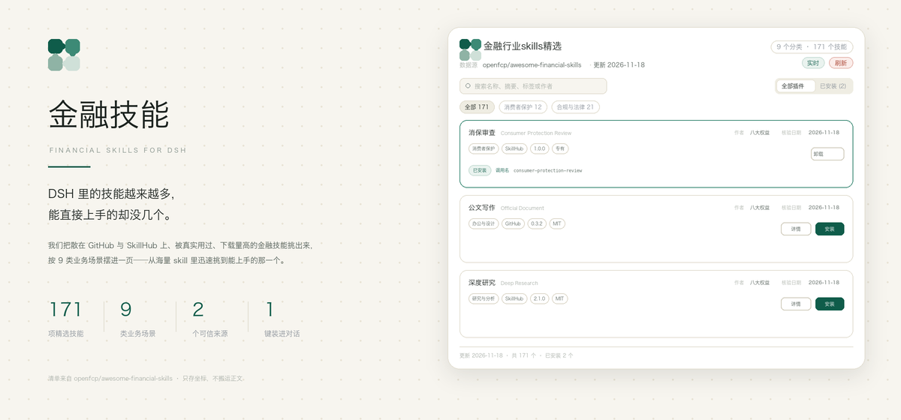
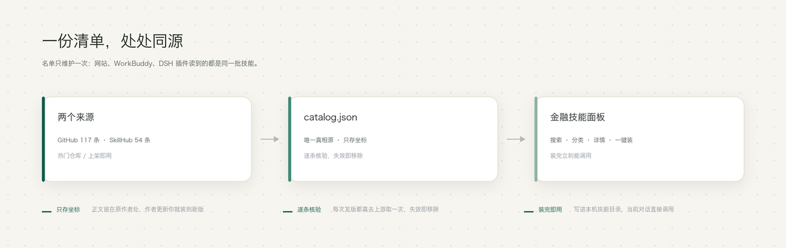
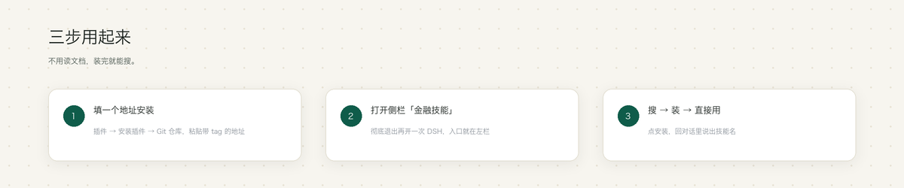

<h1 align="center">DSH 插件：把「金融行业 skills 精选」放进左边栏</h1>

<p align="center"><b>让金融行业的 skill 可搜索、易安装——装上就在当前对话里能用。</b></p>



<p align="center">
  <a href="#三步用起来"><b>→ 三步装上</b></a>　·　
  <a href="https://openfcp.github.io/awesome-financial-skills/">在线清单</a>　·　
  <a href="docs/preview.html">版式预览</a>　·　
  <a href="CHANGELOG.md">更新日志</a>　·　
  <a href="README.en.md">English</a>
</p>

<p align="center">
  
  
  
  
  
  <a href="https://github.com/openfcp/dsh-financial-skills/actions/workflows/ci.yml"></a>
</p>

装一次，DeepSeek Harness（DSH）左侧栏就多一个「金融技能」入口；点开是整页按业务场景摆好的精选清单——搜索、筛选、看正文、一键安装，装完不用重启，当前对话里直接能让它干活。

它的目的只有一个：**让金融从业者在 DSH 里，从海量 skill 中迅速挑到能上手的那一个**，而不是先去读二十份 README 才知道该装什么。

---

## 为什么做这个

DSH 的技能生态正在以周为单位膨胀。难的不再是「找不到技能」，而是**找到了不敢装、装了不会用、用起来不知道边界在哪**。

| 你的困扰 | 这里怎么做 |
|---|---|
| 技能太多，标题一个比一个敢写，装完只会说套话 | 只收**对应具体岗位任务**的：消保审查、对账、KYC、投研问答、公文写作……泛化的「金融问答」不收 |
| 装之前不知道里面到底写了什么 | 点名称看 **SKILL.md 正文 + 文件清单 + 总大小 + 许可 + 来源坐标**，装不装先看清楚 |
| 装完在技能列表里找不到、调不出来 | 装完**立即通知技能注册表**；已安装的卡片直接写出**调用名**，照抄就能用 |
| 想升级，又怕把装好的技能弄丢 | 插件升级不动 `<DSH_HOME>/skills/`；卸载只移到 `.trash`，随时能捞回来 |
| 不知道技能从哪来、能不能商用 | **来源 / 版本 / 协议 / 作者 / 核验日期**逐条标注，缺值写「未标注」而不是留空 |

## 技能从哪来

清单来自 **[openfcp/awesome-financial-skills](https://github.com/openfcp/awesome-financial-skills)**——一份为金融从业者策展的技能目录，也是[在线清单](https://openfcp.github.io/awesome-financial-skills/)与 WorkBuddy 市场的数据源。**同一份 `catalog.json`，三处保持一致。**

**当下：171 条 · 9 类 · 2 个来源（GitHub 117 / SkillHub 54）· 最近核验 2026-11-18。**



收录不按 star 排名，但要求**有真实使用痕迹**：GitHub 上有实际提交与社区反馈，或已在 SkillHub 上架且下载量高；说得出「哪个岗位、什么任务、省掉哪一步」；写得出不适用于什么场景、哪一步必须人来看；来源可查、许可透明。纯 prompt 合集、无执行能力的角色扮演、二次打包他人正文的，一律不收。

| 分类 | 条数 | 典型场景 |
|---|---:|---|
| 消费者保护 | 12 | 消保审查、营销物料合规、投诉处理 |
| 办公与设计 | 23 | 公文写作、PPT 与海报、报告排版 |
| 数据与技术 | 18 | 数据质量、对账、行情与参考数据 |
| 研究与分析 | 26 | 投研问答、深度研究、财报解读 |
| 合规与法律 | 21 | 反洗钱、适当性、合同审查、监管报送 |
| 风险管理 | 6 | 操作风险、流动性、对手方风险 |
| 投资与交易 | 18 | 组合与归因、交易执行、量化回测 |
| 产品与业务 | 28 | 客户经营、产品设计、提案生成 |
| 其他 | 19 | 尚未归入上述场景的工具 |

> **只存坐标，不搬运正文。** 插件里没有内置任何技能的内容：安装时按清单里的坐标，从原作者那里取回最新版（GitHub：整仓 tarball → contents API → raw → jsDelivr；SkillHub：zip）。作者一更新，你下次装到的就是新版。

## 它长什么样

界面上你只需要记住四件事：

- **最上面一行是搜索框**，按名称、摘要、标签、作者都能搜；右边一键切「全部插件 / 已安装」。
- **一行一条长条卡**：中文名 + 英文名，右上角是作者与核验日期，下面四枚胶囊是类别 / 来源 / 版本 / 协议。已安装的卡片换绿色外边框，并写出「调用名」。
- **点名称看详情**：SKILL.md 正文、文件清单、大小、许可、来源坐标一次看全。
- **只有一处刷新**：数据源旁边、贴在「实时 / 非实时」右侧的红色胶囊。刷新失败会写清原因，不会把快照说成实时。

不想先装再看？直接打开 [docs/preview.html](docs/preview.html)，或 `npm run preview` 从真实 CSS 重新生成一份（亮/暗跟随系统）。

## 三步用起来



**1. 填一个地址安装。** DSH →「插件 → 安装插件 → Git 仓库」，粘贴：

```
https://github.com/openfcp/dsh-financial-skills#v0.2.2
```

**2. 彻底退出再打开 DSH。** 菜单栏「DeepSeek Harness → 退出」（或 Cmd+Q），确认活动监视器里没有残留进程再开。侧栏就出现「金融技能」。

**3. 搜 → 装 → 直接用。** 点卡片右侧「安装」，回到对话里直接说：

> 用「消保审查」检查这份营销文案的合规风险，逐条给依据。

装好的技能就出现在当前对话的技能列表里，不需要重启、不需要重新开会话。

> **为什么地址要带 `#v0.2.2`？** git 依赖不带 ref 时，pnpm 会把默认分支的某个 commit 钉进 lockfile；再点安装解析出同一 commit，就只说 `Already up to date`，插件管理器无法归因，于是报「无法从依赖变更中确定安装了哪一个包」。**这不是装坏了，是它已经装着。** 升级请换新 tag 的地址；重装同版本请先卸载。想跟最新可填 `#main`。

## 安装（命令行 / 本地开发）

```sh
# 从 GitHub 装（与界面上填地址等价）
dsh plugin --profile desktop add https://github.com/openfcp/dsh-financial-skills#v0.2.2

# 或者用仓库脚本：克隆 → link: 安装 → 写进 profile.bundles
git clone https://github.com/openfcp/dsh-financial-skills.git
cd dsh-financial-skills && ./scripts/install-local.sh desktop
```

`link:` 指向本地目录，改完代码彻底重启即生效，不需要重新打包。

**升级**：换新 tag 的地址重装，再彻底重启。

**卸载**：

```sh
./scripts/uninstall-local.sh desktop
# 或：dsh plugin --profile desktop remove dsh-financial-skills
#     再从 ~/.dsh/profiles/desktop/package.json 的 dsh.profile.bundles 里删掉 "dsh-financial-skills"
```

插件卸载**不会删除**你已经装好的技能（`<DSH_HOME>/skills/<id>/` 属于用户数据）；需要清掉时在面板里点「卸载」或手动删除。

## 功能一览

| 功能 | 说明 |
| --- | --- |
| 搜索 | 按 id / 中文名 / 英文名 / 摘要 / 标签 / 作者匹配，输入即筛，可与分类、已安装叠加 |
| 分类筛选 | 一行 9 枚胶囊（含「全部」与每类数量）；空分类仍显示，点开提示「该分类暂无工具」 |
| 已安装视图 | 「全部插件 / 已安装 (n)」切换；已安装卡片换 success 色外边框、标出调用名 |
| 卡片信息 | 类别 / 来源 / 版本 / 协议为胶囊，作者 / 核验日期为纯文本且**跨卡片对齐**；缺值写「未标注」 |
| 详情预览 | Markdown 渲染 SKILL.md（截断 64KB）+ 文件清单 + 总大小 + 许可 + 来源坐标 |
| 一键安装 | 按坐标取回正文，校验后整目录改名落位；失败清理暂存，磁盘不留半装目录 |
| 即时生效 | 安装/卸载后主动 `skills.invalidateCache()`，当前对话的技能列表立刻更新 |
| 一键卸载 | 移到 `<DSH_HOME>/skills/.trash/<id>-<时间戳>/`，不直接删除 |
| 离线可用 | 网络不可用或源站降级时回落随包快照，页脚如实标注 `network / cache / snapshot` |
| 刷新 | 只此一处：元信息行「实时 / 非实时」右侧的红色胶囊；失败以错误行呈现，可重试 |

## 配置

所有配置都有默认值，非法值回落默认，**不会让 DSH 启动失败**。在 profile 的 `cordis.patch.yml` 末尾按 `id: financial-skills` 覆盖：

```yaml
- id: financial-skills
  config:
    offline: true          # 只用本地缓存/快照，完全不联网
    cacheTtlMs: 21600000   # 目录缓存 6 小时
```

| 字段 | 默认值 | 说明 |
| --- | --- | --- |
| `indexUrl` | `https://raw.githubusercontent.com/openfcp/awesome-financial-skills/main/catalog.json` | 目录源地址 |
| `indexUrls` | raw.githubusercontent → fastly.jsdelivr → gcore.jsdelivr → cdn.jsdelivr | 目录抓取降级链（错峰竞速，首个有效载荷胜出） |
| `cacheTtlMs` | `21600000`（6 小时） | 目录缓存有效期，过期先返旧目录再后台同步 |
| `offline` | `false` | `true` 时只用缓存/快照 |
| `installRoot` | `<dshHome>/skills` | 技能安装根目录 |
| `dshHome` | `$DSH_HOME`，否则 `~/.dsh` | 用户配置根 |
| `maxFiles` | `200` | 单个技能最大文件数 |
| `maxFileBytes` | `2097152`（2 MB） | 单文件最大字节数 |
| `maxTotalBytes` | `16777216`（16 MB） | 单个技能最大总字节数 |

## HTTP API

Host 半区只注册 **6 条**精确匹配路由（客户端只传 id，不传 URL / 路径）：

| 方法 | 路径 | 入参 | 成功响应 `value` |
| --- | --- | --- | --- |
| GET | `/api/financial-skills/catalog` | `?refresh=1` 强制刷新 | 归一化目录 + `meta`（source / fetchedAt / stale / offline / error） |
| GET | `/api/financial-skills/installed` | — | `{ root, count, skills:[{ id, name, version, description, path, installedAt, managed }] }` |
| GET | `/api/financial-skills/detail` | `?id=` | `{ id, markdown, files, totalBytes, license, version, source }` |
| POST | `/api/financial-skills/install` | `{ "id": "..." }` | `{ id, path, files, bytes, version, license }` |
| POST | `/api/financial-skills/uninstall` | `{ "id": "..." }` | `{ id, trashedTo }` |
| GET | `/api/financial-skills/health` | — | `{ version, upstream, cacheAt, offline, skillRoot, dshHome }` |

统一信封：成功 `{ ok: true, value }`，失败 `{ ok: false, error }`（400 / 403 / 404 / 409 / 502 / 503）。安装会写 `.financial-skills.json`，记录版本、许可、来源坐标、安装时间与文件清单。

## 安全模型

- **只服务本机**：路由先校验来源是 loopback，`Host` 必须是 loopback 名字（挡 DNS rebinding）；POST 要求 `application/json` 且 `Origin` 同源（挡 CSRF）。不监听公网、无账号体系。
- **只认 id**：客户端只能传符合 `^[a-z0-9][a-z0-9-]{0,63}$` 的技能 id，不能传 URL / 路径；下载地址只来自清单坐标 + `resolve` 模板。
- **路径围栏**：写盘前解析出的绝对路径必须仍在 `installRoot` 内，防 `../` 逃逸。
- **先暂存再落位**：下载到 `.staging-<id>-<随机>/`，校验文件数、单文件、总量、相对路径文法后整目录改名；失败清理暂存，磁盘保持原状。
- **不读敏感数据、无遥测**：只看技能目录判断「已安装」，不读凭据或会话内容；请求只发往配置的目录源 / 镜像、`api.skillhub.cn`、GitHub raw/API 与 jsDelivr。

## 常见问题

**侧栏没有「金融技能」？** 确认彻底退出再打开（活动监视器里旧进程都没了）；确认 `~/.dsh/profiles/<profile>/package.json` 的 `dsh.profile.bundles` 里有 `"dsh-financial-skills"`；再 Cmd+R 刷新页面。

**页面显示的是旧数据 / 快照？** 页脚会写明 `source`：`snapshot` 表示用的是随包快照（网络不可达或被配置成 `offline`）。点红色「刷新」重试。

**安装某条技能失败？** 安装需要网络：SkillHub 走 `api.skillhub.cn` 取 zip，GitHub 走 tarball / raw / API / jsDelivr。失败会给出可操作错误并清理暂存目录；批量失败通常是网络问题，不是清单数据问题。

**升级插件后技能没变？** 插件升级不动已装技能。若想用新版 frontmatter 归一化修好的调用名，把该技能「卸载 → 重新安装」一次即可。

**会占很多磁盘吗？** 只写你点过「安装」的技能，每个通常几十 KB 到几 MB；卸载移入 `.trash`，不会自动清理。

## 开发与测试

零 npm 依赖、无构建步骤，要求 Node >= 20。

```sh
node --check index.js client.js lib/*.js test/*.mjs   # 语法
npm test                                              # 单元 + 半区契约测试（离线全绿）
npm run preview                                       # 从 client.js 抽真实 CSS 生成 docs/preview.html
./scripts/run-e2e.sh                                  # 真机 E2E（隔离 DSH_HOME，不碰 ~/.dsh）
```

README 里的三张配图由 `python3 scripts/readme-images.py` 生成（PIL 直绘，2× 超采样后缩小），改文案改配色都在这个脚本里。

## 兼容性

- 在 **DSH 0.2.2-rc.1**（当前桌面版）完整测试通过；要求 DSH >= **0.2.0-rc.2**、Node >= **20**。
- Host 半区只依赖 DSH 公开的 `webServer` 注册能力与 `node:` 内置模块；浏览器半区只手写 bundle，只使用宿主提供的 `react` / `react/jsx-runtime` / `@deepseek-ai/dsh-client-ui-primitives`。
- 若未来 DSH 改动插槽名，入口会消失，但已安装到本地的技能不受影响。

## 许可与免责声明

[MIT](LICENSE) · 作者：[八大权益](https://github.com/openfcp)（OpenFCP）

本项目是社区插件，**与 DeepSeek（深度求索）无隶属、合作或背书关系**，也未获得官方认证。上游清单与各技能正文版权归各自作者所有（MIT 110 条、proprietary 48 条、其他 13 条），以详情里显示的 `license` 为准；安装只代表下载到本地使用，不代表获得再分发授权。

插件只做索引与本地安装，不构成投资建议、法律意见或合规承诺。金融业务落地前请自行完成合规评估与人工复核。
